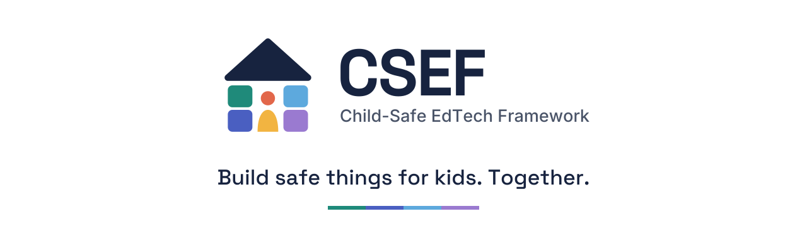

<p align="center">
  <picture>
    <source media="(prefers-color-scheme: dark)" srcset="brand/github/csef-banner-on-dark.png">
    
  </picture>
</p>

# Child-Safe EdTech Framework (CSEF)

An open framework and toolkit for building safe educational software for under-18 students.
It turns EU law, pending EU proposals (EU KIDS Act, Digital Fairness Act) and expert recommendations into
rules a team can check in code, in CI and in review.

> **Status:** v0.14.1, draft for public comment (November 2026).
> **Not legal advice and not a certification.** CSEF produces *pre-compliance* reports. Legal compliance
> depends on facts code cannot show; involve your DPO and legal counsel. See [Limitations](#limitations).
>
> **A framework, not a standard.** CSEF is open guidance and tooling, not a formal standard adopted by a
> standards body (CEN, CENELEC, ETSI, ISO), and using it gives no presumption of conformity with any law. It
> aims to inform future standards and codes of conduct; any such use needs validation by official bodies.
> Until v0.5 it was called the Child-Safe EdTech Standard (CSES). See [why we renamed it](framework/00-introduction.md#a-framework-not-a-standard).

Repository: <https://github.com/eduardon83/child-safe-edtech-framework> ·
Site and Pack Builder: <https://csef.kendirstudios.pt/>

## What you get

| | |
|---|---|
| **The framework** | 131 rules: a core set plus three profiles, **A** educational games, **B** game-based applications and software, **C** gamified applications. Age-band modifiers for 3 to 17. Rules on data, learning data and research, safety by design, commercial practices, AI companions and chatbots, communications, accessibility, security, and design for learning (visuals, sound, motion, motivation). |
| **Three compliance levels** | **1** Legal baseline, **2** Forward-compliant (adds adopted proposals and official benchmarks), **3** Best practice (adds research and expert recommendations). You decide which level of compliance you want in your software. |
| **Sources on every rule** | 89 sources with type, status and verification date. Every report lists the sources it relies on. See [legislation.md](framework/legislation.md) and [research.md](framework/research.md). |
| **Policy questionnaire** | `tooling/policy.py`: answer questions about your boundaries (terminal or local web form). Get your guardrails file, a report that matches each answer with the law and recommendations, a plain-language staff policy, AI agent instructions and a ready CI workflow. Run it again anytime. |
| **Packs** | Add national laws, sector rules, literature or your own red lines without forking. Portugal pack included (draft, not legally reviewed). |
| **Company packs and Pack Builder** | Each organisation sets its minimum level, no-gos, forbidden SDKs and phrases and its own rules, in a web form, then publishes the pack to GitHub. |
| **Scanner** | `tooling/scan.py`: pre-compliance report, prioritised improvement plan, communications inventory, JSON and SARIF. |
| **Dashboard and exports** | `tooling/export.py`: interactive HTML dashboard (levels, age bands, communications, colour-coded findings, checklists, legal counsel section), PDF and Word. |
| **Code-of-conduct comparison** | `tooling/coc.py`: compares any code of conduct with the KIDS Act expectations for codes and with CSEF rules; shows what is covered, partial, missing or in conflict. |
| **Literacy Compass** | `tooling/compass.py`: what does the product teach about digital, media and AI literacy, and how do we know? 45 targets on 8 axes from DigComp 3.0, AILit, UNESCO and EU policy; an evidence level per target (Stated, Designed, Tested, Measured) with the passages behind it; unsupported learning claims; copy that teaches the opposite (hidden curriculum); the next three steps; and a crosswalk to the EU guidelines on digital education content, Swedish Edtech's Kvalitetsportfolio and UNICEF's EdTech for Good. A profile, never a score. |
| **Serious-game pre-check and label package** | `tooling/precheck.py` checks a serious game against 22 published quality criteria (Caserman et al. 2020) using CSEF results and the team's statements with evidence. `tooling/metadata.py` exports the product description as SG-MDF (DIN SPEC 91380) JSON and XML and as schema.org LearningResource, and bundles everything into a label package. Preparation, not a label. |
| **Learning data** | `tooling/evidence.py`: a child-safe profile of the Open Game Data event standard, checks for event files, and open evidence feeds with group figures only (at least 10 players and 3 classes per figure), ready for catalogues such as the Play to Learn Toolkit. Guide online: <https://csef.kendirstudios.pt/learning-data/>. |
| **Workbench** | <https://csef.kendirstudios.pt/workbench/>: for designers, decision makers and researchers. Describe the product in a form, add documents, and run every check that does not read code, in the browser. Nothing is uploaded. Same engine on a computer: `tooling/workbench.py`. |
| **AI review skill** | `skill/csef-review/`: Claude runs the tools, verifies findings, reviews what patterns cannot see, and finalises the reports. |
| **CI** | A GitHub Action, generated Semgrep rules, a PR template. |
| **Templates** | Manifest, DPIA starter, AI risk file, waiver record, instructions for AI coding agents. |

## What's new in v0.14

**Learning data.** Learning games can log what pupils do with the Open Game Data (OGD) event standard. CSEF adds
the limits EU children need: four data tiers, a field-by-field event profile, seven rules (CORE-DAT-19 to 25) and
a tool that checks event files and builds open evidence feeds with group figures only. Catalogues such as the
Play to Learn Toolkit can read the feeds as evidence. Guide: [08-learning-data.md](framework/08-learning-data.md),
also [online](https://csef.kendirstudios.pt/learning-data/).

**Workbench.** Designers, decision makers and researchers can now run every check that does not read code on the
website: describe the product in a form, add documents, and download the reports. Everything runs in the browser
and nothing is uploaded: <https://csef.kendirstudios.pt/workbench/>.

Earlier versions: [CHANGELOG.md](CHANGELOG.md) (one short entry per version) and
[release notes](docs/releases/) (the full story of each release).

## Quick start

```bash
# 1. Describe your product
cp templates/csef.yaml /path/to/your-product/csef.yaml   # then edit it

# 2. Scan, with the dashboard, PDF and Word exports
pip install pyyaml python-docx
python3 tooling/scan.py --repo /path/to/your-product --out-dir csef-report --export html,pdf,docx

# 3. Open the outputs in csef-report/
#    report.md, improvements.md, dashboard.html, report.pdf, report.docx, findings.json, findings.sarif
```

Output folders are relative to the directory you run the command from.

Try it on the examples:

```bash
python3 tooling/scan.py --repo examples/noncompliant-game --out-dir out/bad --export html
python3 tooling/scan.py --repo examples/unity-sample --out-dir out/unity --export html
python3 tooling/scan.py --repo examples/compliant-game --out-dir out/good --level 3
```

### Dashboard, PDF and Word

- `dashboard.html`: self-contained and offline. Status at each level, age bands, communications, filters by
  severity and level, a human-check list you can tick and export as CSV, the improvement plan, a
  "for legal counsel" section and all sources.
- `report.pdf`: print version (Chrome or Chromium; falls back to WeasyPrint).
- `report.docx`: Word version for comments and sign-off (needs `python-docx`).

From an existing scan: `python3 tooling/export.py --input csef-report/findings.json --formats html,pdf,docx`.

### Compare a code of conduct

```bash
python3 tooling/coc.py --input our-code.pdf --name "Our Code" --level 2 --profiles A,C --bands B2,B3 --out-dir coc-report
```

Reads `.txt`, `.md`, `.html`, `.pdf` and `.docx`. Writes `coc-comparison.md`, `.html` and `.json`:

- **Structure**: what the EU KIDS Act proposal expects of codes of conduct (Art. 17, Art. 23, Recital 39):
  objectives, verifiable commitments, criteria for violent, sexual, gambling and self-harm content, in-app
  purchases, contact risks and addictive design, independent redress, age labels, independent monitoring
  with KPIs, reporting, stakeholder involvement.
- **Rules**: for each CSEF rule in scope, *covered*, *partial* (weak or narrow commitment), *missing*, or
  *possible conflict* (the code permits what a rule forbids, e.g. loot boxes "provided that odds are
  disclosed"), with the clauses cited and a suggested addition.

Example: `examples/codes-of-conduct/example-code.md` (fictional).

### What does the product teach? The Literacy Compass

```bash
python3 tooling/compass.py --input docs/ --input marketing/ --input content/ --manifest csef.yaml \
        --csef-findings csef-report/findings.json --out-dir csef-compass
```

Reads design documents, teacher guides, evaluation reports, marketing copy and in-product text (dialogue,
translation files). Writes `compass.md`, `compass.html` and `compass.json`:

- **Learner lens** (information and media, communication and rights, creation, safety and wellbeing, problem
  solving, AI literacy): counted only for what the product claims to teach (`compass.claims` in `csef.yaml`,
  or claims found in its own texts).
- **Design lens** (transparency that teaches, educator and family enablement): every product used by children.
- **Evidence ladder** per target: 0 Not found, 1 Stated, 2 Designed, 3 Tested, 4 Measured. Plans do not count.
- **Claims**: "teaches critical thinking" with nothing designed behind it, or "proven" without measured
  outcomes, is flagged.
- **Hidden curriculum**: copy that teaches the opposite, such as an AI that says it is your best friend.
- **Heading**: the next three steps, shown as the needle of the compass.
- **One dossier, many frameworks**: which evidence also answers the EU guidelines on digital education
  content, Swedish Edtech's Kvalitetsportfolio and UNICEF's EdTech for Good Framework 2.0.

No total, no ranking, no badge. Try it: `python3 tooling/compass.py --input examples/compass/fact-quest --manifest examples/compass/fact-quest/csef.yaml`.

### Your organisation's policy

Answer the questionnaire once. Run it again whenever your boundaries change.

```bash
pip install pyyaml python-docx
python3 tooling/policy.py --web                    # local web form at http://127.0.0.1:8765
python3 tooling/policy.py                          # or in the terminal
python3 tooling/policy.py --answers acme-policy/answers.json --out-dir acme-policy --web   # change it later
```

It writes a kit to share:

| File | For whom |
|---|---|
| `staff-policy` (.md, .html, .pdf, .docx) | Everyone. The policy in plain language: never, only with approval, always, how to check, exceptions. |
| `boundaries-report` (.md, .html, .pdf, .docx) | Management, DPO, legal counsel. Each answer matched with the law (Law, Coming, Recommended), warnings, what adopting each recommendation would take, changes since the last version, sources. |
| `<id>.yaml` | Product teams. The guardrails file the scanner applies. |
| `agent-instructions.md`, `csef-check.yml`, `csef-review.zip` | Developers. Rules for AI coding agents, CI workflow with your pack, the Claude skill. |
| `answers.json` | The policy owner. Input for the next run. |

Answers can only make rules stricter. "Only with approval" never switches off a rule that applies at your
level; the report says so. Try it with `examples/policy/answers.json` (fictional).

**No installation needed:** the questionnaire on the [site](https://csef.kendirstudios.pt/questionnaire/)
makes the same kit (Markdown, HTML, Word, guardrails file, agent instructions, CI workflow) inside the
browser and downloads it as a zip. It runs the same Python code with [Pyodide](https://pyodide.org), loaded
from the jsDelivr CDN; the answers never leave the browser. For PDF, open a document and print it.
The form is in English, Portuguese, Spanish, French, Danish, Norwegian and Swedish (`framework/i18n/`).
Spanish to Swedish are machine translations awaiting native review (`machine_translated: true` shows a notice);
reviewers can edit the YAML and remove that flag. Add a language by copying `pt.yaml`. The documents in the
kit are in English for now.

### Your organisation's pack, by hand


Open the [Pack Builder](https://csef.kendirstudios.pt/pack-builder/), choose your
minimum level and no-gos, add your rules, and publish the pack to your repository. Then list it in each
product's `csef.yaml` under `packs:`. See [framework/02-packs.md](framework/02-packs.md).

### In GitHub Actions

Copy `templates/github/csef-check.yml` into `.github/workflows/` of your product repository. It runs the
scan on each pull request, fails on blocking findings, uploads SARIF to code scanning and attaches the
report and dashboard.

### With Claude

- **Claude Code:** copy `skill/csef-review/` into your project's `.claude/skills/` (or your user skills folder)
  and ask: *"Run a CSEF review of this repository at level 2"* or *"Compare this code of conduct with CSEF."*
- **Claude apps:** download `csef-review.zip` from the latest release (or run `python3 tooling/build.py --zip dist`)
  and upload it as a skill.

## Limitations

CSEF finds signals. It does not prove compliance, and a clean scan is not a clean bill of health.

### What automated checks cover

| Area | Covered |
|---|---|
| **Code and copy** | JavaScript and TypeScript (React, Vue, Svelte), HTML and CSS, Python, Java and Kotlin, Swift and Objective-C, Dart (Flutter), C# (including Unity scripts), Go, Ruby, PHP, Rust, C and C++, Scala, Elixir, GDScript (Godot), Lua, SQL, JSON, YAML, XML, translation files |
| **Game engine text assets** | Unity `.prefab`, `.asset`, `.unity`, `.asmdef` (with the default "Force Text" serialisation); Godot `.tscn`, `.tres` |
| **Dependency lists** | npm, Python (requirements, pyproject), CocoaPods, Swift Package Manager, Gradle, Maven, NuGet and .csproj, Unity Package Manager (`Packages/manifest.json`), Unity External Dependency Manager (`*Dependencies.xml`), Flutter, Go modules, Cargo, Composer, Bundler |
| **Database** | SQL migrations (for example row-level security being disabled, message tables) |
| **UI language** | English and European Portuguese patterns. Other languages need a pack with their phrases (`add_patterns`) |

### What cannot be checked yet

| Not covered | Why | What to do |
|---|---|---|
| **Unreal Blueprints, GameMaker, Construct, other binary engine assets** | Stored in binary formats | Review by hand; export configuration or C++ where possible |
| **Unity scenes saved as binary**, asset-store packages not in `Packages/` | Binary or vendored without a manifest | Use Force Text serialisation; keep SDKs in UPM or EDM4U |
| **Live databases, Firebase and Firestore security rules, cloud IAM** | Not read from live systems; Firebase rules not yet parsed | Review access policies by hand (CORE-SEC-02) |
| **Hosting regions from Terraform or cloud consoles** | Infrastructure-as-code not parsed yet | Declare regions in `csef.yaml` `third_parties` |
| **Third-party dashboards** (chat moderation settings, analytics retention, ad network settings) | Configured outside the repository | Confirm by hand; the communications audit marks safeguards "not found" as REVIEW, not BLOCK |
| **No-code tools without a repository** (e.g. Bubble) | No code to read | Use the manifest, human checks and dashboard |
| **Other UI languages** | Patterns exist only for English and PT-PT | Add phrases in a country pack; the Claude skill reads any language |
| **Runtime behaviour** (what the app actually shows, sends or stores) | Static analysis does not run the product | Test on devices; inspect network traffic |

### Processes code cannot show

These are always **human checks** in the report and dashboard:

- Contracts and roles: processor agreements, legal basis, the school as controller.
- DPIA, child rights impact assessment, AI risk file and their sign-off.
- Moderation in practice, the safeguarding procedure (CORE-CHT-08), moderator training and escalation.
- Age assurance and guardian tools as experienced by families.
- Accessibility with real assistive technology, and testing with children and teachers.
- Commercial practices in content: product placement, sponsorship and influencer marketing.
- Whether a code of conduct is applied in practice (the comparison tool reads wording, not behaviour).

### The code-of-conduct comparison

It matches English wording. A clause can use the right words and still be too narrow, or meet a rule in
words the tool does not know. Every result must be confirmed by a person, or by the Claude skill, which
compares meaning and reads any language.

## Read the framework

1. [Introduction](framework/00-introduction.md): profiles, age bands, levels, severities, how to describe your results; why CSEF is a framework, not a standard
2. [Regulatory map](framework/01-regulatory-map.md): which instrument says what, and the EU KIDS Act education exemption
3. [Legislation](framework/legislation.md): every legal and policy source, the provisions that matter, the rules that use them
4. [Research](framework/research.md): every study, its findings and limits, the rules that use it
5. [Packs](framework/02-packs.md): extending with national rules, literature and company policies
6. [Design for learning](framework/03-design-and-motivation.md): what research says about visuals, motion and rewards
7. [Literacy Compass](framework/04-literacy-compass.md): what a product teaches about digital, media and AI literacy; [target catalogue](framework/compass/catalogue.md)
8. [Several countries](framework/05-several-countries.md): preparing the architecture for multi-country products and shared infrastructure (EDU-EDIC)
9. [Bullying](framework/06-bullying.md): what the product can do, and who can respond; default procedure for schools without a plan
10. [Labels and metadata](framework/07-labels-and-metadata.md): serious-game pre-check, SG-MDF and LRMI export, label package
11. [Learning data](framework/08-learning-data.md): logging play safely, research studies, open evidence feeds ([online](https://csef.kendirstudios.pt/learning-data/))
12. [Rule catalogue](framework/catalogue/index.md): every rule with requirement, rationale, improvement and sources
13. [Self-assessment checklists](self-assessment/)

## Repository layout

```
framework/        rules.yaml + sources.yaml (single source of truth), coc-topics.yaml, questionnaire.yaml, docs, generated catalogue
                 compass/targets.yaml + crosswalk.yaml (Literacy Compass), generated compass/catalogue.md
                 serious-games/criteria.yaml (serious-game pre-check)
                 data/profile.yaml + evidence-ontology.yaml (learning data)
packs/           country and extra packs (pt.yaml, _template.yaml)
tooling/         scan.py, comms.py, export.py, coc.py, policy.py, compass.py, precheck.py, metadata.py, evidence.py,
                 workbench.py, mdpage.py, build.py, examples.py (example reports for the website), site templates, generated Semgrep rules
skill/           csef-review skill for Claude (generated copies + SKILL.md + references)
templates/       manifest, DPIA starter, AI risk file, waiver, agent instructions, GitHub files
self-assessment/ generated checklists per profile and level
examples/        non-compliant, compliant and Unity sample products; example company pack and code of conduct;
                 evidence-feed (fictional event file and feed)
tests/           test-suite
docs/            GitHub Pages site (csef.kendirstudios.pt): home, Workbench, questionnaire, Pack Builder, Learning data
                 guide, submission preview (generated), example reports (tooling/examples.py), release notes
brand/           logo, icons, colours and fonts (see brand/README.md)
```

Edit `framework/rules.yaml`, `framework/sources.yaml`, `framework/coc-topics.yaml`, `framework/compass/*.yaml` or `packs/*.yaml`, then run
`python3 tooling/build.py`. Never edit generated files by hand; CI checks they are up to date.

## Licence

- Framework text, rules, sources, packs, checklists and templates: [CC BY 4.0](LICENSE-CC-BY-4.0.txt)
- Code (scanner, tools, build, action, skill scripts): [Apache 2.0](LICENSE-APACHE-2.0.txt)

See [LICENSE](LICENSE) for which applies where.

## Maintainers and governance

Maintained by Kendir Studios (Worlds4Education, Lda., Portugal), Eduardo Nunes and contributions from the EdTech
community. See [GOVERNANCE.md](GOVERNANCE.md) and [CONTRIBUTING.md](CONTRIBUTING.md).
