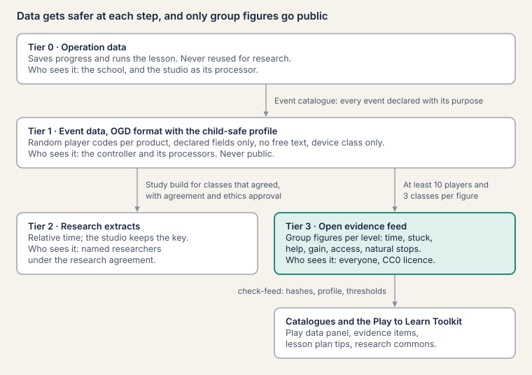

# Learning data: collect what helps, publish only what is safe

Learning games can tell us a lot: where pupils get stuck, how long a level takes, whether they learn. CSEF's
Learning Data module shows how to log play so that makers learn what works and teachers get real evidence,
without breaking EU law. It adopts the **Open Game Data (OGD)** event standard and adds the limits EU children
need.

The module does three things:

1. **Guides makers.** A field-by-field profile of the OGD event format says what may be logged, how player codes
   are made, and what never leaves the studio. Seven rules (CORE-DAT-19 to 25) and scanner checks catch the
   common traps.
2. **Separates four tiers of data.** Operation data, event data, research extracts and open evidence. Only the
   last is public, and it holds group figures only.
3. **Feeds catalogues with evidence.** Makers publish a small, checked evidence feed (time per level, where
   pupils get stuck, use of accessibility settings, learning gain). Catalogues such as the Play to Learn Toolkit
   read it as evidence, labelled as the maker's own data until someone independent checks it.

This is pre-compliance guidance for teams and their DPO, not legal advice.

## 1. What Open Game Data teaches us

OGD ([Gagnon, Swanson and Harpstead 2024](https://par.nsf.gov/servlets/purl/10593375)) gives us a ready event
format, a pipeline and proof that shared game data serves research at scale. CSEF reuses all three and changes
how far the data travels.

**The pipeline.** A Logger stores events from the game. Detectors add inferred events (idleness, frustration).
Features are then computed per player and per population, plus higher-order features that compare a player with
the population. Every stage writes plain TSV files with a README.md and a machine-readable META.json.

**The event standard** ([case study](https://opengamedata.io/case-studies/event-data-standard)). Every event
carries the game, a player code, the session, time, its order in the session, the event name and source, event
data, game state, player metadata and three version numbers. Versions use branch names, so a study build
(`1.0.0-newscript`) sits beside the main build without breaking the sequence.

**What researchers do with it.** Test versions of a game on large audiences, map how players progress, classify
play styles, replay sessions, detect struggle in real time, and give teachers summaries of how a class is doing.
Published uses include detecting computational thinking, predicting quitting and "wheel spinning", and assessing
content knowledge.

**Scale.** 21 games log with OGD, adding 2 to 10 million events a day; 12 have detectors and feature extractors;
data is released monthly on a public website.

### Where it clashes with EU law for children

| OGD choice | Why it is a problem in the EU | CSEF answer |
|---|---|---|
| "Capture then analyze": log enough to rebuild the whole session | GDPR Art. 5(1)(b)(c): purpose limitation and data minimisation | Declare, then capture: an event catalogue tied to stated purposes; full capture only in a study build (CORE-DAT-19, 25) |
| Public event-level data with anonymous player codes | A stable code plus exact times can single out a child (WP216). For the studio that holds the link, the data stay personal (CJEU, EDPS v SRB) | Event-level data never public; open release is population features only, with minimum group sizes (CORE-DAT-24) |
| One code that follows a player across games | Cross-product profiling; purpose limitation | Codes scoped to one product; linking only inside an approved study (CORE-DAT-20) |
| Detectors for frustration, quitting, struggle | Inferences about a child are personal data; per-child labels risk surveillance and automated decisions | Population level for design; per child only with the assessment rules and teacher control (CORE-DAT-22) |
| Player metadata left to the implementer | Invites demographics and special-category proxies | Allow-list: age band and declared settings only |

The OGD team takes privacy seriously: their schema avoids personal information by design. The gap is legal, not
ethical. US practice treats anonymous codes as safe to publish; EU law asks who could re-identify.

## 2. Four data tiers

Each tier holds less about any one child than the one before, and each step has a gate CSEF can check. Only
tier 3 is public.



| Tier | Holds | Who sees it | Gate |
|---|---|---|---|
| 0 Operation data | What the game needs to run: progress, settings | The school, and the studio as its processor | Never reused for research |
| 1 Event data | OGD events with the child-safe profile | The controller and its processors | Event catalogue (CORE-DAT-19) |
| 2 Research extracts | Events with relative time, no time zone, no key | Named researchers under an agreement | Study build, agreement, ethics approval (CORE-DAT-25, B-DAT-01) |
| 3 Open evidence | Group figures only, csef-evidence-0.1 | Everyone, CC0 | At least 10 players and 3 classes per figure (CORE-DAT-24) |

Tier 3 is built from tier 1 by the studio; tier 2 exists only when a study runs. A game that never does research
can still publish a feed, as long as the schools' contract allows it.

## 3. The child-safe event profile

Makers keep the OGD format, so OGD tools still work, and follow one verdict per field. The profile is
machine-readable in [`framework/data/profile.yaml`](data/profile.yaml); `tooling/evidence.py check-events` reads it.

| OGD field | CSEF verdict | Why |
|---|---|---|
| game id | Keep | Public fact |
| instance id | Random per class or match. Never a class or school name | A school name identifies a small group |
| player id | Random, made by the game. Never a hash of an email, name or account id. One product only. New code each school year | A hash of a known value can be reversed by guessing; cross-product codes enable profiling |
| session id | Random | Needed to order events |
| timestamp, offset | Keep in tier 1. Relative time in research extracts. Month only in open evidence | Exact times plus a school timetable can point to one class |
| sequence indexes | Keep | Order events without exact time |
| event name, source | Keep. Every name declared in the event catalogue | The catalogue is the allow-list |
| event data | Numbers, booleans and declared values only. No typed text, voice, drawings, chat or names | Free text is where children write who they are |
| game state | Declared keys only | Context for analysis, low risk |
| player metadata | Age band and the settings in use. Nothing else without research approval | Demographics and needs can reveal special-category data (CJEU, C-184/20) |
| versions and source hash | Keep. Study builds use a branch name such as `2.1.0-study` | Separates study data from normal use |
| device facts (not an OGD field) | One device class: tablet, laptop, desktop, phone, other | Screen size, user agent, fonts and advertising ids are fingerprinting (EDPB Guidelines 2/2023) |
| IP address (not an OGD field) | Never in events. Server logs truncated, short retention | Direct identifier (CORE-DAT-04) |

### The event catalogue

Every product that logs events keeps an event catalogue: each event, each field with its type, and the purpose
it serves. Start from [`templates/event-catalogue.yaml`](../templates/event-catalogue.yaml). Nothing that is not
in the catalogue is sent (CORE-DAT-19). The scanner compares event names in code with the catalogue, and
`check-events` compares event files with it.

An event may also have an `evidence_role` (session_start, unit_start, unit_complete, help, stuck, setting,
assessment, mode, session_end). The roles let `build-feed` compute the open evidence features without custom code.

## 4. Detectors, inferences and engagement metrics

Use inferences to improve the game for everyone, not to label a child. Measure learning and healthy use, never
time captured.

| Use | Allowed? | Conditions |
|---|---|---|
| A detector finds where many players get stuck, so the team redesigns level 4 | Yes | Population level; the result feeds design |
| A dashboard shows the teacher which tasks the class finds hard | Yes | Class totals; B-OPS-01 (learning, not surveillance) |
| A per-pupil "frustrated" or "disengaged" label shown to the teacher | No, by default | Only with `assessment` declared, a teacher who can override, and the assessment rules (CORE-DAT-22) |
| The game adapts difficulty from a detector | Only as `ai_adaptive` | High-risk path (B-EVL-01), explainable and contestable |
| Emotion inferred from camera, voice or face | No | AI Act Art. 5(1)(f) bans emotion recognition in education; CORE-DAT-08, CORE-DAT-10 |
| Retention, daily active users, streak length or sessions per week as success targets | No, for children | CORE-DAT-23: the KIDS Act and DFA aims against design that keeps children playing |
| Typical time to finish a level, reported to teachers for planning | Yes | Descriptive only; never a target to increase |

The line between the last two rows matters. "Median 14 minutes for level 2" helps a teacher plan a lesson.
"Raise average session length by 10%" is an engagement target, and CSEF flags it.

## 5. Legal basis, device storage and research studies

Most trouble comes from one move: data collected to run the game is quietly reused for research. CSEF makes each
new purpose a visible step.

1. **Who decides.** In school use, the school is usually the controller and the studio a processor
   (CORE-DAT-02). A processor may only use data on the school's instructions. If the studio wants the data for its
   own research or product improvement, it becomes a controller for that purpose and needs its own legal basis.
2. **A new purpose needs a check.** Reuse for research must be compatible (GDPR Art. 6(4)) and protected by
   safeguards (Art. 89): minimisation, pseudonymisation, access control. B-DAT-01 asks for a data sharing
   agreement and ethics approval.
3. **Device storage.** Storing or reading a player code on the device falls under ePrivacy Art. 5(3), whatever the
   technology: cookies, local storage, app storage ([EDPB Guidelines 2/2023, v2](https://www.edpb.europa.eu/system/files/2024-10/edpb_guidelines_202302_technical_scope_art_53_eprivacydirective_v2_en_0.pdf)).
   Research logging is not strictly necessary to play. So the normal build runs with research logging off, and a
   study build turns it on only where consent or another valid route exists (CORE-DAT-25).
4. **Study builds, not silent switches.** Research runs in a branch version (`2.1.0-study`) given only to classes
   that agreed. Families and pupils get a child-friendly notice (CORE-DAT-12) and can leave the study without
   leaving the lesson.
5. **Keys stay home.** The studio keeps the link between player codes and accounts. Researchers receive extracts
   without the key. The CJEU held that pseudonymised data may not be personal for a recipient who cannot
   reasonably re-identify, while they stay personal for the controller who holds the key
   ([EDPS v SRB, C-413/23 P](https://curia.europa.eu/juris/liste.jsf?num=C-413/23%20P)). CSEF still treats extracts
   about children as personal data: the safe reading until guidance settles.

**On the watch list.** The Digital Omnibus proposal (COM(2025) 837) would make the definition of personal data
relative and move device-storage consent into a new GDPR Art. 88a, with exemptions for aggregated audience
measurement. As of October 2026 the data part had not reached trilogue, and the EDPB and EDPS called the definition
change a red line. CSEF relies on neither change.

## 6. The open evidence feed (csef-evidence-0.1)

The feed holds group figures that help teachers choose and plan, published only for groups large enough that no
child or class can be picked out. It has **one row per figure**, so a figure can be given for everyone and also for
an age band, a country or a period. The Play to Learn Toolkit reads the same layout with the same rules.
Definitions: [`framework/data/evidence-ontology.yaml`](data/evidence-ontology.yaml).

| Feature | Stats | What it measures, per unit (level, mission) or for the whole game | Use in catalogues |
|---|---|---|---|
| EV-TIME | p25, p50, p75 | Active minutes to finish a unit; for the whole game, minutes played in total | Lesson time and number of lessons |
| EV-DONE | share | Share of players who started a unit and finished it | Difficulty curve |
| EV-STUCK | share | Share of players a detector marked as stuck | Where a teacher should step in |
| EV-HELP | share | Share of players who used hints or help | Support needed |
| EV-GAIN | pre, post, change, effect_size | Scores before and after a check, with the instrument named on every row | Evidence of learning |
| EV-ACCESS | share, per setting | Share of players using each accessibility setting | Universal Design for Learning |
| EV-STOP | share | Share of sessions that end at a natural stopping point | No pressure to keep playing |
| EV-MODE | share, per mode | Share of sessions played solo, in teams, teacher-led | Play mode |
| EV-DEVICE | share, per device | Device class mix | Technical fit |
| CONTEXT | count, list | Players, classes, age bands, countries, languages, months | Shown next to every figure |

Each row of `population.tsv` has these columns:

```csv
unit,unit_order,feature,category,stat,value,players,classes,age_band,country,period,instrument
Level 1,1,EV-TIME,,p50,7.3,60,6,all,all,2026-09/2026-11,
Whole game,0,EV-GAIN,,change,0.3,60,6,all,all,2026-09/2026-11,"Fractions check, 10 items"
Whole game,0,EV-ACCESS,captions,share,0.22,60,6,all,all,2026-09/2026-11,
Level 1,1,EV-DONE,,share,0.97,35,3,all,PT,2026-09/2026-11,
```

(Shown with commas here; the file uses tabs.) `unit_order` is 0 for the whole game and 1, 2, 3 for units in
playing order. `age_band` is `all` or B1 to B5, `country` is `all` or a two-letter code, `period` is
`YYYY-MM/YYYY-MM`.

**Thresholds.** At least **10 players and 3 classes** behind every row. Groups that are smaller are left out, never
merged by hand: a level few pupils reach, an age band or a country with too few classes. Three classes stop a
teacher reading their own class in the totals. Player counts are rounded to 5, periods to the month. No per-class,
per-school or per-player rows, no free text, no retention, daily users, streaks or revenue.

**Figures per country.** Events do not carry a country. The controller can give `build-feed` a small file that
says which country each class is in (`--class-countries`, columns `instance_id,country`). It stays with the
controller; only countries with enough classes of their own get figures.

**Package.** One folder or zip: `population.tsv`, `README.md` (licence CC0 1.0, citation, game and maker),
`META.json` (`ontology`, `csef_profile`, `title`, `game`, `maker`, `period`, `licence`, `purposes`,
`collected_under`, `thresholds`, `citation`, and the Open Game Data dataset keys) and `MANIFEST.json` with the
SHA-256 of each file. An example built from fictional data is in
[`examples/evidence-feed/feed/`](../examples/evidence-feed/feed/).

## 7. Run it

```bash
# 1. Check an event file against the profile and your catalogue
python3 tooling/evidence.py check-events --events events.tsv --catalogue docs/event-catalogue.yaml --out-dir csef-events

# 2. Build the open evidence feed (thresholds applied, small cells removed)
python3 tooling/evidence.py build-feed --events events.tsv --catalogue docs/event-catalogue.yaml \
  --game "Garden of Numbers" --maker "Example Studio" --collected-under own_study \
  --approval "Ethics committee, ref. 2026-031" --instrument "Fractions check, 10 items" \
  --class-countries class-countries.csv --out-dir feed --zip

# 3. Check a feed before you publish it, or before you show someone else's
python3 tooling/evidence.py check-feed --feed feed.zip --out-dir csef-feed-check

# 4. Scan the product: the manifest block and the code
python3 tooling/scan.py --repo . --out-dir csef-report
```

People who do not use a terminal can run steps 1 and 3, and the description checks, in the
[Workbench](https://csef.kendirstudios.pt/workbench/) on the CSEF website. It runs in the browser; files stay on
the computer.

Describe the data in `csef.yaml`:

```yaml
data_collection:
  event_standard: ogd-0.1            # ogd-0.1 | xapi-sg | custom | none
  event_catalogue: docs/event-catalogue.yaml
  purposes: [operation, improvement] # + evaluation, research
  player_id: {kind: random, scope: product, renews: school_year}
  cross_product_linking: false
  detectors: population_only         # population_only | teacher_view (needs assessment)
  research:                          # required when purposes lists research
    study_branch: study
    agreement: docs/research/agreement.md
    ethics_approval: "Ethics committee, ref. 2026-031"
    key_holder: studio               # researchers never get the key
    default_on: false
  open_evidence:
    ontology: csef-evidence-0.1
    collected_under: own_study       # or processor_for_school (link the contract clause in school_instruction)
    min_players: 10
    min_classes: 3
    url: https://example.org/evidence/
```

Products that log nothing write `data_collection: {event_standard: none}`.

**Other event formats.** OGD is CSEF's reference format. Studios on xAPI (including the serious-game profile
xAPI-SG) can apply the same profile: actor accounts follow the player id rules, `result` and `extensions` follow
the event data rules, and the same feed can be computed from statements. A mapping table is planned.

## 8. The rules

| Rule | Level | What it asks | How it is checked |
|---|---|---|---|
| CORE-DAT-19 | MUST, level 1 | Every logged event and field is in the event catalogue, with its purpose | Manifest; event names in code |
| CORE-DAT-20 | MUST, level 1 | Random player codes, one product, not derived from identifiers | Code (hashing of emails, names, ids); manifest |
| CORE-DAT-21 | MUST, level 1 | No fingerprinting attributes in telemetry | Code |
| CORE-DAT-22 | MUST, level 2 | Inferences stay at population level unless the assessment rules apply | Manifest and human check |
| CORE-DAT-23 | SHOULD, level 2 | No engagement targets for children | Code (metric names) and human check |
| CORE-DAT-24 | MUST, level 1 | Open releases hold group figures only, with the thresholds | Manifest; check-feed |
| CORE-DAT-25 | MUST, level 1 | Research logging runs only in a study build | Manifest |

B-DAT-01 (research use is separated) now includes the study build and "keys stay home". Full text in the
[rule catalogue](catalogue/core.md).

## 9. Measuring the tools themselves

The same method lets a tool show its own use, impact and capacity with daily counters and no personal data: no
accounts, no cookies, no IP addresses, nothing stored on the device. With nothing stored on or read from the
device, ePrivacy Art. 5(3) is not triggered. The page sends an event name and a few declared values; the server
adds 1 to a counter for that day and drops the event.

| Question | Example counters |
|---|---|
| Use: who uses it, for what | Searches, questions answered or skipped, guides downloaded |
| Impact: does it change choices | Plans created per game, warnings opened, rules fixed between two scans |
| Capacity: can the people keep up | Items harvested, checked and published; queue age; coverage by language |

CSEF's command-line tools send nothing. The CSEF website has no analytics.

## Sources

- [Gagnon, Swanson and Harpstead (2024), Open Game Data, IEEE CoG](https://par.nsf.gov/servlets/purl/10593375)
- [Open Game Data, event data standard case study](https://opengamedata.io/case-studies/event-data-standard)
- [EDPB Guidelines 2/2023 on the technical scope of Art. 5(3) ePrivacy, v2.0](https://www.edpb.europa.eu/system/files/2024-10/edpb_guidelines_202302_technical_scope_art_53_eprivacydirective_v2_en_0.pdf)
- [EDPB Guidelines 01/2025 on pseudonymisation](https://edpb.europa.eu/news/news/2025/edpb-adopts-pseudonymisation-guidelines-and-paves-way-improve-cooperation_en)
- [CJEU, C-413/23 P, EDPS v SRB](https://curia.europa.eu/juris/liste.jsf?num=C-413/23%20P)
- [Digital Omnibus Regulation proposal, COM(2025) 837](https://www.europarl.europa.eu/legislative-train/theme-a-new-plan-for-europe-s-sustainable-prosperity-and-competitiveness/file-digital-package)
- [Article 29 Working Party, Opinion 05/2014 on Anonymisation Techniques (WP216)](https://ec.europa.eu/justice/article-29/documentation/opinion-recommendation/files/2014/wp216_en.pdf)
- Every source with its status and date checked: [legislation.md](legislation.md) and [research.md](research.md).
